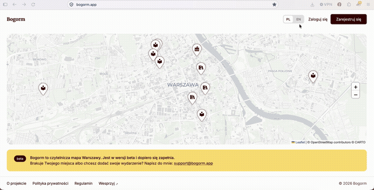

# Bogorm

An interactive map of Warsaw's reading life — bookshops, libraries,
and literary places, with events and personal bookmarks.



**Live:** [bogorm.app](https://bogorm.app)

## Features

- **Map of reading places** — libraries, bookshops and cultural centres in Warsaw
- **Events** — what's on this week, plus upcoming and archived events
- **Accounts and bookmarks** — save places and events, keep them in one list
- **Two languages** — Polish and English, for both the interface and the content
- **Works on mobile** — responsive layout for phone, tablet and desktop

## Tech stack

| Layer | Tools |
|---|---|
| Frontend | Nuxt 4, Vue 3, TypeScript, Leaflet, @nuxtjs/i18n, @nuxt/content |
| Backend | Python, Django, Django REST Framework, PostGIS |
| Auth | JWT (simplejwt) with refresh-token rotation and blacklisting |
| i18n | django-modeltranslation for content, gettext for API messages |
| Tests | pytest-django, factory_boy |
| Infra | Docker, Nginx, Let's Encrypt, DigitalOcean droplet |
| CI/CD | GitHub Actions → images on GHCR → deploy to the droplet |
| Analytics | Self-hosted Umami |

## Some decisions worth a look

- **Cacheable public map.** `/map` returns the same data for everyone.
  Bookmark state comes from a separate `/bookmarks/ids/` call and merges on the client.
- **Geo queries in the database.** PostGIS filters places by the visible
  map area (bounding box).
- **Data rules in the schema.** A bookmark points to exactly one place or event —
  a `CheckConstraint` and partial unique constraints enforce it.
- **One token refresh at a time.** The API client checks JWT expiry before
  each request and shares a single refresh promise between parallel calls.
- **Language via `Accept-Language`.** No `?lang=` parameter. Translated fields
  fall back to Polish when the English version is empty.

## Run locally

Requirements: Docker.

```bash
git clone https://github.com/ni4yja/bogorm.git
cd bogorm
cp .env.example .env        # fill in the values
docker compose up -d        # starts frontend, backend and database
```

First run — set up the database and add sample data:

```bash
docker compose exec web python manage.py migrate
docker compose exec web python manage.py seed_places
docker compose exec web python manage.py seed_events
docker compose exec web python manage.py createsuperuser
```

Open:

- App: `http://localhost:3000`
- Django Admin: `http://localhost:8000/admin/`

Tests:

```bash
docker compose exec web pytest tests/ -v
```

API docs (Swagger) are available at `http://localhost:8000/api/docs/`.

## Roadmap

- Web accessibility
- Search and map filter by category
- Thematic reading routes

## Background

Built during the Women Go Tech Acceleration Program (2026),
with mentor Ieva Astašauskė.

Prototype design: Anastasiia Shkonda.

Newsletter about the work on Bogorm: [*Na marginesie*](https://buttondown.com/bogorm) (in Polish).

## Built by

Liuba Kuibida — [liubuntu.tech](https://liubuntu.tech) · [LinkedIn](https://www.linkedin.com/in/liuba-kuibida)